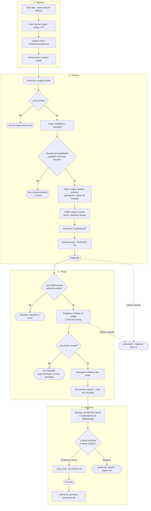

# 00.2 — Flujo Cliente de punta a punta

| Campo | Valor |
|---|---|
| Fase | 00 Núcleo FARO |
| Estado | REVIEW (pendiente de aprobación humana) |
| Criterio de aceptación | Registro → publicar → seguir → confirmar |
| Evidencia | Diagrama (sección 2) |
| Depende de | 00.1 Alcance del MVP (modalidades y categorías) |

## 1. Resumen

El Cliente se registra con el mínimo de datos y publica un mandado de una de las seis categorías de 00.1. FARO lo valida antes de que aparezca en el marketplace. Después, el Cliente sigue el mandado por estados y lo cierra confirmando la entrega con un PIN. Los pasos de pago aparecen en el flujo, pero están **BLOCKED por H3**: no se implementan hasta tener un PSP confirmado por escrito.

## 2. Diagrama

Las líneas discontinuas son cancelaciones del Cliente. Los nodos redondeados son estados finales o de espera; los estados formales se definen en 00.4.

## 3. Paso a paso

### 3.1 Registro

| Paso | Qué hace el Cliente | Qué hace FARO | Datos (DSGVO) |
|---|---|---|---|
| R1 | Abre la app. | Muestra la app en alemán; el Cliente puede cambiar el idioma. | Ninguno. |
| R2 | Introduce su email y el código OTP que recibe. | Crea la cuenta (Supabase Auth). | Email. |
| R3 | Acepta AGB y Datenschutzerklärung y declara ser mayor de 18 años. | Guarda la versión aceptada y la fecha. | Versión y fecha de aceptación. Los textos dependen de H1. |
| R4 | Elige su nombre visible (por ejemplo, «Ana M.»). | — | Nombre visible. |

No se piden dirección, teléfono ni método de pago en el registro. Cada dato se pide en el paso que lo necesita.

### 3.2 Publicar

| Paso | Qué hace el Cliente | Qué hace FARO |
|---|---|---|
| P1–P2 | Introduce una dirección o código postal. | Resuelve la zona. Si no está activa, ofrece la lista de espera y no deja publicar. |
| P3 | Elige modalidad (RECOGER o HACER) y una de las categorías activas en su zona. | Muestra solo las categorías activas en la zona (00.6). |
| P4 | Responde el checklist de la categoría: ya está pagado, no hay importe pendiente, no es un artículo prohibido, cabe en el tamaño y peso máximos. | Si alguna respuesta no cumple, bloquea la publicación y explica el motivo. |
| P5 | Indica origen y destino, la ventana de tiempo deseada, una descripción breve, el tamaño aproximado y el código o la autorización de recogida (si la categoría lo pide). | Guarda cifrados el código de recogida y la autorización. |
| P6 | — | Valida las reglas de la zona (categoría activa, distancia máxima) y calcula precio, distancia y tiempo estimado. La fórmula de precio es de la Fase 03. |
| P7 | Revisa el resumen: categoría, origen, destino, ventana, precio total desglosado (tarifa de servicio + Vergütung). | — |
| P8 | Autoriza el pago. | **BLOCKED H3.** Sin PSP no se implementa; el prototipo puede simularlo. |
| P9 | — | Publica el mandado en el marketplace de la zona. |

**Qué ve el Helfer antes de aceptar:** categoría, zonas aproximadas de origen y destino (barrio o código postal), ventana de tiempo, tamaño y Vergütung. **No ve** la dirección exacta, el nombre del Cliente ni el código de recogida.

### 3.3 Seguir

| Paso | Qué ve el Cliente | Reglas |
|---|---|---|
| S1 | «Buscando Helfer». | Si nadie acepta antes de que termine la ventana, el mandado expira. El Cliente puede republicarlo o cerrarlo. El plazo es configurable por zona. |
| S2 | «Aceptado» + nombre visible del Helfer. | El Helfer acepta voluntariamente. Solo ahora ve la dirección exacta y el código de recogida. |
| S3 | Si el mandado no es realizable, «No realizable» con el motivo. | Motivos: pago pendiente en el mostrador, pedido no listo, artículo prohibido. El tratamiento económico se define en la Fase 11 (BLOCKED por H3). |
| S4 | «Recogido» + evidencia (foto del bulto o del comprobante). | La foto no debe mostrar datos de terceros. |
| S5 | «En camino» + chat del mandado. | El chat solo está abierto mientras dura el mandado. No se intercambian teléfonos. |

**Cancelación por el Cliente:** antes de que alguien acepte, la cancelación no tiene coste. Después de aceptar, las reglas dependen de la Fase 11 (BLOCKED por H3). Este flujo no contiene ninguna penalización para el Helfer (regla H2).

### 3.4 Confirmar

| Paso | Qué pasa | Reglas |
|---|---|---|
| C1 | El Helfer entrega. | **RECOGER y entregas en mano:** el receptor da al Helfer un PIN de 4 dígitos que ve en su app; el Cliente puede compartir el PIN con otra persona que reciba en su nombre. **Devolución de paquete:** foto del Einlieferungsbeleg. |
| C2 | El Cliente confirma la recepción o reclama. | Si no hace nada, se confirma automáticamente al vencer un plazo configurable por zona. |
| C3 | Cobro final. | **BLOCKED H3.** |
| C2R | Reclamación. | Va a soporte (Fase 15). Los daños los cubre el seguro (H5). |
| C5 | Valoración opcional. | **Pendiente de H2.** No tiene efecto automático sobre el Helfer (ver P6 en preguntas abiertas). |

**Borrado de datos:** códigos de recogida, autorizaciones, PIN y fotos de evidencia se borran tras un plazo configurable después de cerrar el mandado. El historial del Cliente conserva solo categoría, fechas, importe y estado.

## 4. Tradeoffs

- **Sin seguimiento GPS en vivo en el MVP.** El Cliente ve estados y chat, no la posición del Helfer. Así se reducen los datos de ubicación del Helfer (DSGVO) y se evita algo que puede leerse como control sobre el Helfer (H2). A cambio, la experiencia es menos precisa que la de una app de reparto.
- **PIN de entrega obligatorio.** Añade un paso al Cliente, pero da una prueba clara de entrega para reclamaciones y para el seguro (H5).
- **Checklist declarativo en P4.** FARO no puede comprobar si un pedido está realmente pagado; confía en la declaración del Cliente. Si no lo está, el mandado acaba como «no realizable».
- **Solo email para registrarse.** Es el mínimo de datos. El teléfono reduciría el fraude, pero es otro dato personal más; queda como pregunta abierta.

## 5. Preguntas abiertas (decisión humana)

- **P1. Verificación del Cliente.** ¿Basta email + OTP, o pedimos además el teléfono verificado antes de la primera publicación? Propuesta: solo email en el MVP y revisarlo en la Fase 04 (FARO Trust).
- **P2. Plazo de confirmación automática.** Propuesta: 24 h después de la entrega, configurable por zona.
- **P3. Plazo de borrado** de códigos, PIN y fotos. Propuesta: 30 días tras el cierre, para cubrir reclamaciones. Hay que revisarlo con el plazo de reclamación del seguro (H5).
- **P4. Expiración de la publicación.** Propuesta: al terminar la ventana de tiempo que eligió el Cliente.
- **P5. Datos del Helfer que ve el Cliente.** Propuesta: nombre visible y foto opcional.
- **P6. Valoraciones.** Una valoración que afecte al acceso del Helfer a mandados puede leerse como gestión algorítmica (Directiva de Trabajo en Plataformas). Propuesta: en el MVP la valoración es feedback privado para FARO, sin efecto automático, hasta resolver H2.

## 6. Impacto en otras tareas

- **00.3 Flujo Helfer:** es la otra cara de S1–C1: qué ve antes de aceptar, cuándo se revelan los datos, la evidencia de recogida y la entrega con PIN.
- **00.4 Estados del mandado:** estados provisionales a formalizar como máquina de estados: `draft`, `published`, `expired`, `accepted`, `not_feasible`, `picked_up`, `in_transit`, `delivered`, `confirmed`, `disputed`, `cancelled`, `closed`.
- **00.5 Modelo de datos:** las entidades salen de este flujo: cuenta, aceptación de AGB, mandado, evidencia, PIN, mensaje de chat y valoración. Los códigos de recogida se guardan cifrados.
- **00.6 Reglas multi-zona:** plazos de expiración, confirmación automática y borrado, categorías activas y distancia máxima.
- **Fase 03 y Fase 11:** fórmula de precio, cancelaciones y cobros (Fase 11 BLOCKED por H3).

## 7. Cómo se verifica

- El diagrama cubre registro, publicar, seguir y confirmar, y GitHub lo renderiza (Mermaid).
- Cada salida del flujo (lista de espera, no se puede publicar, expirado, no realizable, cancelado, reclamación, cerrado) tiene un estado final.
- Los pasos de pago están marcados BLOCKED H3, y la valoración, pendiente de H2.
- En cada paso se pide solo el dato que ese paso necesita.
