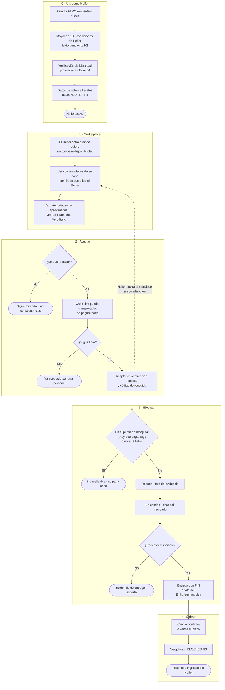

# 00.3 — Flujo Helfer de punta a punta

| Campo | Valor |
|---|---|
| Fase | 00 Núcleo FARO |
| Estado | REVIEW (pendiente de aprobación humana) |
| Criterio de aceptación | Marketplace → aceptar → ejecutar → cobrar |
| Evidencia | Diagrama (sección 2) |
| Depende de | 00.1 Alcance del MVP, 00.2 Flujo Cliente |

## 1. Resumen

El Helfer es una persona normal que, cuando quiere, entra al marketplace de su zona, elige un mandado y lo acepta voluntariamente. FARO no le asigna mandados, no le exige disponibilidad y no le penaliza por rechazar, ignorar o soltar un mandado (regla H2). Ejecuta el mandado sin tocar dinero y cobra su Vergütung al confirmarse la entrega. El registro definitivo depende de **H2** (encuadre legal), el cobro de **H3** (PSP) y los datos fiscales de **H1**.

## 2. Diagrama

Las líneas discontinuas son salidas voluntarias del Helfer. Los nodos redondeados son estados finales o de espera; los estados formales se definen en 00.4.

## 3. Paso a paso

### 3.0 Alta como Helfer

| Paso | Qué hace el Helfer | Qué hace FARO | Dependencia |
|---|---|---|---|
| A1 | Usa su cuenta FARO o crea una (email + OTP, como en 00.2). | Una misma cuenta puede ser Cliente y Helfer. | — |
| A2 | Declara ser mayor de 18 años y acepta las condiciones de Helfer. | Guarda versión y fecha de aceptación. | **H2**: el texto depende del encuadre legal. |
| A3 | Verifica su identidad. | Usa un proveedor externo; FARO no guarda copias del documento, solo el resultado. | Fase 04 (FARO Trust). Puede resolverlo el KYC del PSP (H3). |
| A4 | Introduce sus datos de cobro y los fiscales. | — | **BLOCKED H3** (cobro) y **H1** (datos fiscales; ver P2). |
| A5 | Elige su medio de transporte habitual (a pie, bici, transporte público, coche). | Solo sirve como filtro por defecto; el Helfer puede cambiarlo cuando quiera. | — |

Hasta que H2 y H3 estén resueltos, nadie puede pasar a «Helfer activo» fuera de un piloto controlado.

### 3.1 Marketplace

- El Helfer entra cuando quiere. **No hay turnos, ni estado «conectado», ni disponibilidad obligatoria.**
- Ve los mandados `published` de las zonas que ha elegido, ordenados de forma transparente: por distancia y por inicio de la ventana. **No hay ranking por rendimiento del Helfer** (H2).
- Los filtros los elige el Helfer: distancia máxima, categorías, tamaño y franja horaria.
- **Avisos opcionales (opt-in):** el Helfer puede pedir que se le avise de mandados que encajen con sus filtros. Por defecto están desactivados.
- **Qué ve antes de aceptar:** categoría, zonas aproximadas de origen y destino (barrio o código postal), ventana de tiempo, tamaño, distancia estimada y Vergütung neta.
- **Qué no ve antes de aceptar:** la dirección exacta, el nombre del Cliente y el código de recogida.

### 3.2 Aceptar

| Paso | Qué pasa | Reglas |
|---|---|---|
| K1 | El Helfer decide si lo quiere hacer. | Rechazar o ignorar no tiene consecuencias. **No se mide una tasa de aceptación.** |
| K2 | Confirma un checklist: puede transportar ese tamaño, sabe que no debe pagar nada y conoce los artículos prohibidos. | Es informativo y no se repite si ya lo ha confirmado para esa categoría. |
| K3 | FARO comprueba en el servidor que el mandado sigue libre. | Aceptación atómica: el primero que confirma se lo queda. |
| K4 | Aceptado: se revelan la dirección exacta, el código o la autorización de recogida y el nombre visible del Cliente. | Hay un límite de mandados aceptados a la vez por Helfer, configurable por zona (00.6). Es una regla de seguridad, no una penalización. |

**Soltar un mandado:** antes de recogerlo, el Helfer puede soltar un mandado aceptado. Vuelve a `published` si su ventana sigue abierta; si no, pasa a `expired`. **No hay penalización ni registro con efecto sobre el Helfer.**

### 3.3 Ejecutar

| Paso | Qué pasa | Reglas |
|---|---|---|
| E1 | En el punto de recogida, el Helfer muestra el código o la autorización. | **Si piden cualquier pago, o el pedido no está listo, el Helfer no paga nada:** marca «no realizable» con un motivo y, opcionalmente, una foto. |
| E2 | Recoge y hace una foto de evidencia. | La foto muestra el bulto o el comprobante, sin datos de terceros. |
| E3 | Va al destino. Puede escribir al Cliente por el chat del mandado. | No se intercambian teléfonos. No hay GPS en vivo en el MVP (00.2). |
| E4 | Si el receptor no está, avisa por el chat y espera un tiempo configurable. | Si no hay respuesta, se abre una incidencia de entrega y soporte decide (ver P4). El Helfer no deja nada sin autorización del Cliente por escrito en el chat. |
| E5 | Entrega. | En mano: el receptor le da el PIN de 4 dígitos. En una devolución de paquete: foto del Einlieferungsbeleg. |

### 3.4 Cobrar

| Paso | Qué pasa | Dependencia |
|---|---|---|
| C1 | El Cliente confirma la entrega o vence el plazo de confirmación automática. | Plazo configurable por zona (00.2, P2). |
| C2 | FARO paga la Vergütung al Helfer a través del PSP. | **BLOCKED H3.** |
| C3 | El Helfer ve su historial de mandados e ingresos, exportable. | Sirve para su declaración fiscal; el formato depende de H1. |

## 4. Tradeoffs

- **El Helfer elige (pull), FARO no asigna (push).** El emparejamiento es menos eficiente y puede haber mandados que nadie acepte. A cambio, se refuerza la independencia del Helfer frente a la Directiva de Trabajo en Plataformas (H2).
- **Primero en confirmar, se lo queda.** Es simple y transparente, pero favorece a quien mira la app más a menudo. La alternativa (varios Helfer se ofrecen y el Cliente elige) añade un paso y un tiempo de espera.
- **Sin penalizaciones ni métricas de aceptación.** Algunos Helfer soltarán mandados. El efecto se mitiga devolviendo el mandado al marketplace, no castigando.
- **Verificación de identidad obligatoria.** Añade fricción al alta, pero el Helfer recibe direcciones exactas y objetos de terceros.

## 5. Preguntas abiertas (decisión humana)

- **P1. Encuadre del Helfer (H2).** Decide qué se le pide en el alta. Por ejemplo, si tiene que estar dado de alta como autónomo (Gewerbe), si hay límites de ingresos o de frecuencia y qué dicen las condiciones de Helfer.
- **P2. Obligación de informar a Hacienda (PStTG / DAC7).** Es probable que FARO, como plataforma de servicios personales, tenga que recoger datos fiscales del Helfer (fecha de nacimiento, Steuer-ID, dirección) y comunicar sus ingresos al BZSt. Hay que confirmarlo con el Steuerberater (H1) antes del alta real.
- **P3. Mandados a la vez por Helfer.** Propuesta: 1 en el MVP, configurable por zona.
- **P4. Receptor ausente.** Propuesta: esperar 10 minutos tras avisar por el chat; después, soporte decide entre un nuevo intento acordado o devolver el objeto al origen. El tratamiento económico va a la Fase 11 (BLOCKED por H3).
- **P5. Verificación de identidad.** ¿Un proveedor propio (Fase 04) o la del PSP (H3)? Propuesta: esperar a H3 y reutilizar la del PSP si la ofrece.
- **P6. Soltar mandados repetidamente.** Propuesta: sin efecto automático; solo una métrica agregada y anónima de mandados soltados, para mejorar el producto. Cualquier medida individual queda como configuración desactivada hasta resolver H2.

## 6. Impacto en otras tareas

- **00.4 Estados:** añade la transición «el Helfer suelta el mandado» (`accepted` → `published` o `expired`) y la incidencia de entrega.
- **00.5 Modelo de datos:** perfil de Helfer, resultado de la verificación (sin copia del documento), filtros, medio de transporte, aceptaciones de condiciones y evidencias.
- **00.6 Multi-zona:** mandados a la vez por Helfer, espera al receptor ausente, avisos y orden del marketplace.
- **00.7 Gates:** P2 (PStTG / DAC7) se añade como gate FINANCE ligado a H1.

## 7. Cómo se verifica

- El diagrama cubre marketplace → aceptar → ejecutar → cobrar, y renderiza en Mermaid.
- El flujo no contiene penalizaciones, turnos, disponibilidad obligatoria, ranking por rendimiento ni tasa de aceptación (regla H2).
- El Helfer no paga ni cobra nada en ningún paso; el cobro de la Vergütung está marcado BLOCKED H3.
- Cada salida (no lo quiere, ya aceptado, soltado, no realizable, incidencia de entrega) tiene un destino definido.
