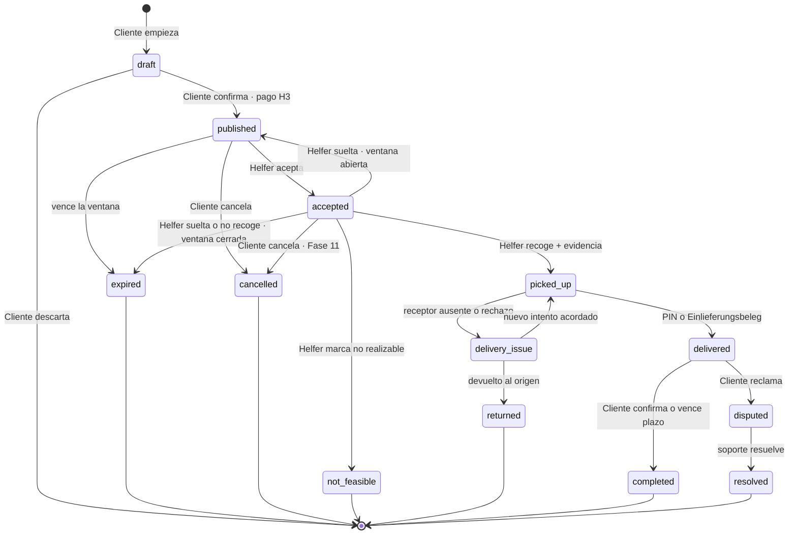

# 00.4 — Estados del mandado

| Campo | Valor |
|---|---|
| Fase | 00 Núcleo FARO |
| Estado | REVIEW (pendiente de aprobación humana) |
| Criterio de aceptación | Máquina de estados con transiciones |
| Evidencia | Diagrama (sección 2) + tabla de transiciones (sección 4) |
| Depende de | 00.2 Flujo Cliente, 00.3 Flujo Helfer |

## 1. Resumen

Un mandado tiene **13 estados**: 7 de recorrido normal o intermedio y 6 finales. Solo cambia de estado mediante las transiciones de la tabla de la sección 4, ejecutadas en el servidor; ninguna app puede escribir el estado directamente. **Ninguna transición penaliza al Helfer** (regla H2). Los efectos económicos de cada transición están marcados BLOCKED H3 o Fase 11.

## 2. Diagrama

## 3. Estados

| Estado | Nombre (DE) | Tipo | Significado |
|---|---|---|---|
| `draft` | Entwurf | Inicial | El Cliente está creando el mandado. No es visible en el marketplace. |
| `published` | Veröffentlicht | Activo | Visible en el marketplace de la zona y esperando Helfer. |
| `accepted` | Angenommen | Activo | Un Helfer lo ha aceptado. Ve la dirección exacta y el código de recogida. |
| `picked_up` | Abgeholt | Activo | El objeto está en manos del Helfer, camino del destino. |
| `delivery_issue` | Zustellproblem | Activo | No se pudo entregar (receptor ausente o rechazo en el Paketshop). Lo gestiona soporte. |
| `delivered` | Zugestellt | Activo | Entregado con PIN o comprobante. Espera confirmación del Cliente. |
| `disputed` | Reklamation | Activo | El Cliente ha reclamado tras la entrega. Lo gestiona soporte. |
| `completed` | Abgeschlossen | Final | Confirmado por el Cliente o por plazo vencido. |
| `expired` | Abgelaufen | Final | Nadie lo recogió dentro de la ventana. |
| `cancelled` | Storniert | Final | Cancelado por el Cliente o por soporte. |
| `not_feasible` | Nicht durchführbar | Final | No se pudo recoger: pago pendiente, pedido no listo o artículo prohibido. |
| `returned` | Zurückgebracht | Final | Tras una incidencia de entrega, el objeto volvió al origen. |
| `resolved` | Geklärt | Final | Soporte cerró la reclamación. El resultado se guarda aparte (Fase 15). |

Los nombres alemanes son claves i18n, no texto en el código. Los 13 IDs técnicos son estables.

## 4. Transiciones

| # | De → A | Actor | Condición (guard) | Efectos |
|---|---|---|---|---|
| T1 | `draft` → `published` | Cliente | Categoría activa en la zona, checklist superado, validaciones de 00.6, pago autorizado (**BLOCKED H3**) | Aparece en el marketplace; arranca el temporizador de expiración. |
| T2 | `published` → `accepted` | Helfer | Mandado aún libre (aceptación atómica); Helfer activo; no supera su límite de mandados a la vez | Revela al Helfer la dirección exacta, el código de recogida y el nombre visible del Cliente; avisa al Cliente; abre el chat. |
| T3 | `published` → `expired` | Sistema | Termina la ventana de tiempo | Avisa al Cliente con la opción de republicar; libera el pago (**H3**). |
| T4 | `published` → `cancelled` | Cliente | — | Sin coste para el Cliente; libera el pago (**H3**). |
| T5 | `accepted` → `published` | Helfer | El Helfer suelta el mandado y la ventana sigue abierta | Retira al Helfer el acceso a los datos revelados; avisa al Cliente. **Sin penalización.** |
| T6 | `accepted` → `expired` | Helfer o sistema | El Helfer suelta el mandado con la ventana cerrada, o la ventana termina sin recogida | Retira el acceso a los datos; avisa a ambos. **Sin penalización al Helfer.** |
| T7 | `accepted` → `cancelled` | Cliente | — | Avisa al Helfer; el tratamiento económico se define en la Fase 11 (**BLOCKED H3**). |
| T8 | `accepted` → `not_feasible` | Helfer | Motivo obligatorio: `payment_required`, `not_ready`, `prohibited_item` u `other` | Foto opcional; avisa al Cliente; Fase 11 (**H3**). |
| T9 | `accepted` → `picked_up` | Helfer | Foto de evidencia subida | Avisa al Cliente. |
| T10 | `picked_up` → `delivered` | Helfer | PIN correcto, o foto del Einlieferungsbeleg en una devolución de paquete | Arranca el plazo de confirmación automática; avisa al Cliente. |
| T11 | `picked_up` → `delivery_issue` | Helfer | Aviso previo por el chat y espera configurable cumplida, o rechazo en el destino | Abre un caso de soporte. |
| T12 | `delivery_issue` → `picked_up` | Soporte | El Cliente y el Helfer acuerdan un nuevo intento | Vuelve a la entrega normal. |
| T13 | `delivery_issue` → `returned` | Soporte | El objeto se devuelve al origen; el Helfer sube la evidencia | Fase 11 (**H3**). |
| T14 | `delivered` → `completed` | Cliente o sistema | El Cliente confirma, o vence el plazo de confirmación | Cobro final y Vergütung (**BLOCKED H3**); habilita la valoración opcional (pendiente de H2). |
| T15 | `delivered` → `disputed` | Cliente | Dentro del plazo de confirmación; motivo obligatorio | Congela el cobro (**H3**); abre un caso de soporte. |
| T16 | `disputed` → `resolved` | Soporte | Resolución registrada | Fase 11 / seguro (**H5**). |

Cualquier otra combinación de estado de origen y destino se rechaza.

## 5. Reglas de implementación

1. **Solo el servidor cambia estados.** Hay una única función de transición (por ejemplo, `transition_errand(errand_id, to_status, reason)`) que valida la tabla de la sección 4. RLS impide actualizar `status` directamente desde las apps.
2. **Concurrencia.** Cada mandado lleva un número de versión. T2 (aceptar) usa una actualización condicional sobre `status = 'published'`, de modo que solo una aceptación puede ganar.
3. **Auditoría.** Cada transición añade un evento inmutable: estado de origen y destino, actor, rol, motivo y fecha.
4. **Temporizadores.** La expiración (T3, T6) y la confirmación automática (T14) las ejecuta un proceso programado en el servidor. Los plazos vienen de la configuración de la zona (00.6), nunca del código.
5. **Idempotencia.** Repetir la misma transición (reintento de red) no duplica efectos.
6. **Visibilidad de datos por estado.** El Helfer ve la dirección exacta y el código de recogida solo en `accepted`, `picked_up` y `delivery_issue`. En `delivered` solo conserva el chat. En los estados finales pierde el acceso; soporte mantiene acceso en `disputed` y `delivery_issue`.
7. **Borrado.** Al llegar a un estado final se programa el borrado de códigos, PIN y evidencias según el plazo de retención de la zona (00.2, P3).
8. **H2.** Ninguna transición genera sanciones, bloqueos ni puntuaciones automáticas sobre el Helfer. Si en el futuro se añaden, serán configuración desactivada por defecto (00.6).

## 6. Tradeoffs

- **13 estados en lugar de 6–7.** Es más trabajo de implementación y de pruebas. A cambio, cada incidencia real (no realizable, receptor ausente, reclamación) tiene su estado y su auditoría, en lugar de acabar en un genérico `cancelled`.
- **`picked_up` sin un estado `in_transit` aparte.** Sin GPS en vivo, distinguirlos no aporta información al Cliente.
- **`delivered` y `completed` separados.** Así hay un periodo de reclamación antes del cobro final, a costa de retrasar la Vergütung hasta la confirmación o el fin del plazo.
- **Reclamaciones tras `completed`** quedan fuera de la máquina de estados. Las gestiona soporte como caso aparte (Fase 15), para no reabrir mandados ya cobrados.

## 7. Preguntas abiertas (decisión humana)

- **P1.** ¿Se puede cancelar en `picked_up`? Propuesta: no; el Cliente usa el chat o soporte, porque el objeto ya está en manos del Helfer.
- **P2.** ¿Se puede republicar automáticamente al expirar? Propuesta: no; el Cliente decide con un toque y se crea un mandado nuevo con los mismos datos.
- **P3.** Motivos de `not_feasible`. ¿Basta con `payment_required`, `not_ready`, `prohibited_item` y `other`?

## 8. Cómo se verifica

- El diagrama renderiza en Mermaid y cada flecha corresponde a una fila de la sección 4 (T1–T16).
- Cada estado no final tiene al menos una salida, y cada estado final llega a `[*]`.
- Las salidas de 00.2 y 00.3 tienen su estado: lista de espera (fuera del mandado), no realizable, expirado, soltado, cancelado, incidencia de entrega, reclamación y cerrado.
- Ninguna transición contiene penalizaciones al Helfer.
