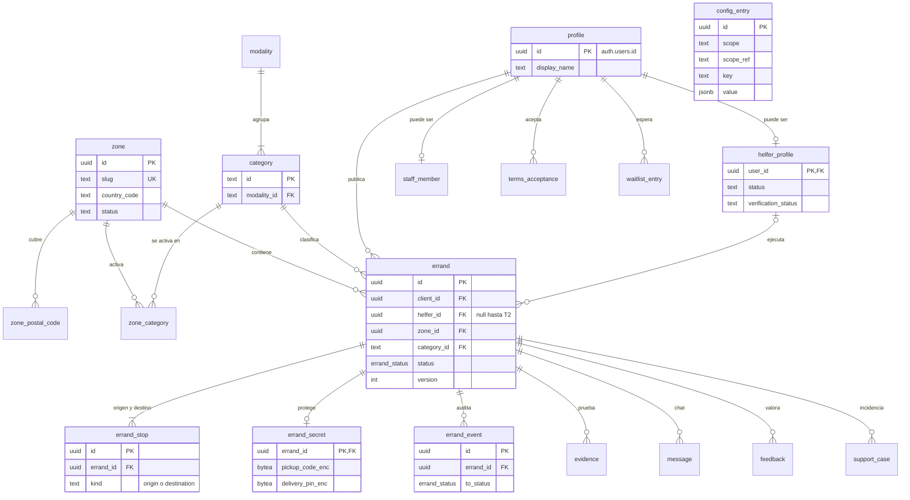

# 00.5 — Modelo de datos candidato (v0)

| Campo | Valor |
|---|---|
| Fase | 00 Núcleo FARO |
| Estado | REVIEW (pendiente de aprobación humana) |
| Criterio de aceptación | Entidades mínimas del MVP definidas |
| Evidencia | Esquema (diagrama ER en la sección 2 + tablas en la sección 3) |
| Depende de | 00.1, 00.2, 00.3, 00.4 |

## 1. Resumen

El MVP necesita **19 tablas** en PostgreSQL (Supabase), agrupadas en cuatro bloques: zonas y catálogo, personas, mandado y soporte. Es un modelo **candidato**: aún no es una migración. Se convertirá en SQL en la Fase 08.

Quedan **fuera a propósito**:

- Pagos, cobros y Vergütung: **BLOCKED H3**.
- Datos fiscales del Helfer: pendientes de **H1** (PStTG / DAC7).
- Copias de documentos de identidad: no se guardan nunca.

## 2. Diagrama ER

El diagrama muestra solo claves y campos clave; las columnas completas están en la sección 3.

`config_entry` no tiene relaciones de clave foránea: su ámbito (global, país o zona) se resuelve como describe 00.6.

## 3. Tablas

Convenciones de todas las tablas:

- IDs `uuid` y fechas `timestamptz` en UTC; la hora local se calcula con la `timezone` de la zona.
- Importes en céntimos (`int`) con su `currency`.
- Los textos de la app no se guardan en tablas: las categorías y los estados usan claves i18n.

### 3.1 Zonas y catálogo

| Tabla | Columnas | Notas |
|---|---|---|
| `zone` | `id`, `slug` (único), `country_code` (ISO 3166-1, p. ej. `DE`), `name`, `timezone` (p. ej. `Europe/Berlin`), `status` (`draft`, `waitlist`, `active`, `paused`), `created_at` | Una zona es datos, no código (00.6). |
| `zone_postal_code` | `postal_code` (PK), `zone_id` | Cada código postal pertenece como mucho a una zona. |
| `config_entry` | `id`, `scope` (`global`, `country`, `zone`), `scope_ref` (`null`, código de país o `zone.id`), `key`, `value` (jsonb), `valid_from`, `created_by`, `created_at` | Configuración versionada; nunca se edita, se añade una entrada nueva (00.6). |
| `modality` | `id` (`pickup`, `task`), `enabled` | Catálogo de 00.1. |
| `category` | `id` (los 6 IDs de 00.1), `modality_id`, `sort_order`, `enabled` | Añadir una categoría exige cambiar 00.1. |
| `zone_category` | `zone_id`, `category_id`, `enabled` | Qué categorías están activas en cada zona. |

### 3.2 Personas

| Tabla | Columnas | Notas |
|---|---|---|
| `profile` | `id` (= `auth.users.id`), `display_name`, `locale`, `created_at`, `deleted_at` | El email vive en Supabase Auth, no se duplica. |
| `helfer_profile` | `user_id`, `status` (`pending`, `active`, `paused_by_helfer`, `deactivated`), `verification_status` (`none`, `pending`, `verified`, `failed`), `verified_at`, `verification_ref`, `transport_mode`, `preferences` (jsonb: zonas, categorías, distancia), `notify_opt_in` (por defecto `false`), `created_at` | `verification_ref` es la referencia del proveedor, sin copia del documento. Sobre `deactivated`, ver P2. |
| `staff_member` | `user_id`, `role` (`support`, `admin`), `created_at` | Acceso a FARO Control. |
| `terms_acceptance` | `id`, `user_id`, `doc_type` (`terms_client`, `terms_helfer`, `privacy`), `doc_version`, `country_code`, `accepted_at` | Incluye la declaración de mayoría de edad. Los textos dependen de H1 y H2. |
| `waitlist_entry` | `id`, `user_id`, `postal_code`, `created_at` | Zona no activa (00.2, P2). |

### 3.3 Mandado

| Tabla | Columnas | Notas |
|---|---|---|
| `errand` | `id`, `client_id`, `helfer_id` (null hasta T2), `zone_id`, `category_id`, `status` (enum `errand_status` con los 13 estados de 00.4), `version`, `window_start`, `window_end`, `description`, `size_class`, `origin_area`, `destination_area` (barrio o código postal, la parte pública), `distance_m`, `estimated_minutes`, `service_fee_cents`, `helfer_amount_cents`, `currency`, `not_feasible_reason`, `created_at`, `published_at`, `accepted_at`, `delivered_at`, `closed_at`, `purge_after` | Lo que ve el marketplace sale solo de esta tabla. La fórmula de precio es de la Fase 03. |
| `errand_stop` | `id`, `errand_id`, `kind` (`origin`, `destination`), `place_name` (p. ej. el nombre de la tienda), `street`, `house_number`, `postal_code`, `city`, `country_code`, `lat`, `lng`, `notes` | Dirección exacta: datos protegidos. Exactamente 2 por mandado en el MVP. |
| `errand_secret` | `errand_id`, `pickup_code_enc`, `authorization_path` (Storage), `delivery_pin_enc`, `purge_after` | Cifrado (Supabase Vault / pgsodium). Se borra al vencer `purge_after`. |
| `errand_event` | `id`, `errand_id`, `from_status`, `to_status`, `actor_id`, `actor_role` (`client`, `helfer`, `system`, `support`), `reason_code`, `created_at` | Auditoría de 00.4. Solo se añaden filas. |
| `evidence` | `id`, `errand_id`, `kind` (`pickup_photo`, `receipt_photo`, `not_feasible_photo`, `return_photo`), `storage_path`, `uploaded_by`, `created_at`, `purge_after` | Fotos en un bucket privado de Storage. |
| `message` | `id`, `errand_id`, `sender_id`, `body`, `created_at` | Chat del mandado. Se borra con el mandado. |
| `feedback` | `id`, `errand_id`, `author_id`, `about_role` (`client`, `helfer`), `score` (1–5, opcional), `comment`, `created_at` | **Privado para FARO**, sin efecto automático (H2; 00.2, P6). |

### 3.4 Soporte

| Tabla | Columnas | Notas |
|---|---|---|
| `support_case` | `id`, `errand_id`, `opened_by`, `kind` (`delivery_issue`, `dispute`, `other`), `status` (`open`, `closed`), `resolution_code`, `notes`, `created_at`, `closed_at` | Lo abren T11 y T15 de 00.4. Lo detalla la Fase 15. |

## 4. Acceso (RLS)

RLS está activo en todas las tablas. Por defecto se deniega todo y se abre solo lo siguiente:

| Tabla | Cliente | Helfer | Soporte / admin |
|---|---|---|---|
| `zone`, `zone_postal_code`, `modality`, `category`, `zone_category` | Lectura | Lectura | Escritura solo admin |
| `config_entry` | Lectura de claves públicas | Lectura de claves públicas | Escritura solo admin |
| `profile` | Su fila; `display_name` de su Helfer asignado | Su fila; `display_name` de su Cliente asignado | Lectura |
| `helfer_profile` | — | Su fila | Lectura; cambios de estado registrados |
| `errand` | Los suyos | Los `published` de sus zonas (solo las columnas públicas) y los que tiene asignados | Lectura |
| `errand_stop`, `errand_secret` | Los suyos | Solo si está asignado y el mandado está en `accepted`, `picked_up` o `delivery_issue` (00.4, regla 6) | Solo con un caso de soporte abierto |
| `errand_event`, `evidence`, `message` | Los de sus mandados | Los de sus mandados asignados | Lectura |
| `feedback` | Insertar el suyo | Insertar el suyo | Lectura |
| `support_case` | Los suyos (lectura) | Los suyos (lectura) | Lectura y escritura |

**Nadie escribe `errand.status` directamente.** Solo lo cambia la función de transición de 00.4, que se ejecuta con permisos de servidor.

## 5. DSGVO: retención y borrado

- `errand_secret`, `evidence` y `message` se borran al vencer `purge_after`. El plazo viene de la configuración de la zona (00.2, P3).
- `errand_stop` se reduce a código postal en ese mismo momento; la dirección exacta no se guarda indefinidamente.
- **Borrado de cuenta:** `profile.display_name` se anonimiza, se borra el usuario de Auth y los mandados cerrados conservan solo los datos agregados. Los datos contables que haya que conservar por ley dependen de H1 y H3.
- `errand_event` no contiene datos personales más allá de `actor_id`, que queda huérfano tras anonimizar.

## 6. Fuera del modelo v0

| Qué | Por qué | Cuándo |
|---|---|---|
| Pagos, autorizaciones, Vergütung, facturas | **BLOCKED H3** | Fase 11 |
| Datos fiscales del Helfer (PStTG / DAC7) | Pendiente de H1 | Tras H1 |
| Reglas de precio | Fase 03 | Fase 03 (en `config_entry`) |
| Tokens de notificaciones push | Detalle técnico | Fase 08 |
| Historial de versiones de los textos legales | Pendiente de H1 y H2 | Fase 02 |

## 7. Tradeoffs

- **`errand_stop` y `errand_secret` separados de `errand`.** Hay más joins, pero RLS es simple: el marketplace nunca toca tablas con datos exactos.
- **Códigos postales en lugar de polígonos** para definir zonas. Es simple y suficiente para Alemania en el MVP; PostGIS puede llegar después sin romper el modelo (00.6).
- **`config_entry` genérica (clave/valor jsonb).** Es flexible y versionada, pero se pierde el tipado de la base de datos: la validación va en la aplicación con un esquema (00.6).
- **Sin libreta de direcciones del Cliente.** Hay que reescribir la dirección en cada mandado, a cambio de guardar menos datos.

## 8. Preguntas abiertas (decisión humana)

- **P1.** ¿Libreta de direcciones guardadas para el Cliente? Propuesta: no en el MVP.
- **P2.** `helfer_profile.status = deactivated`. Desactivar a un Helfer (por ejemplo, por fraude) puede considerarse una decisión de gestión que la Directiva de Plataformas regula. Propuesta: solo por decisión humana documentada y nunca automática, a validar en H2.
- **P3.** ¿Supabase en región UE (Fráncfort)? Propuesta: sí, obligatorio, por DSGVO.

## 9. Cómo se verifica

- Cada paso de 00.2 y 00.3 y cada transición de 00.4 tiene dónde guardarse.
- Cada dato personal tiene una política de acceso (sección 4) y de borrado (sección 5).
- Nada de pagos ni de datos fiscales está modelado mientras H3 y H1 sigan abiertos.
- El diagrama ER renderiza en Mermaid.
