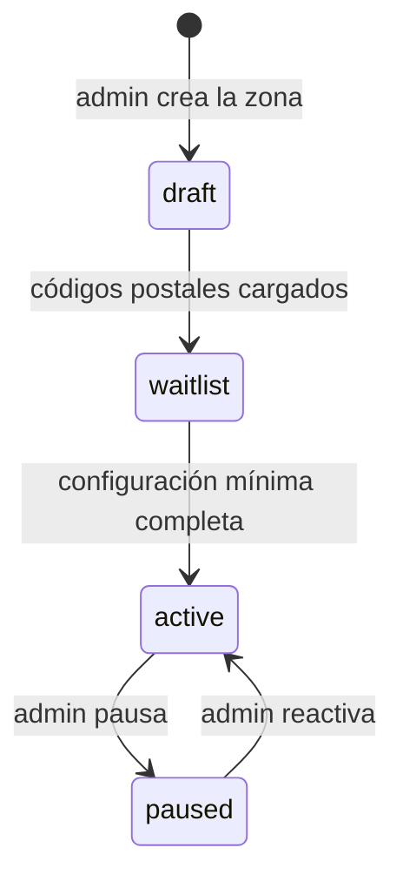

# 00.6 — Reglas multi-zona

| Campo | Valor |
|---|---|
| Fase | 00 Núcleo FARO |
| Estado | REVIEW (pendiente de aprobación humana) |
| Criterio de aceptación | Todo lo regional configurable, nada fijo a una ciudad |
| Evidencia | Este documento |
| Depende de | 00.1–00.5 |

## 1. Resumen

FARO funciona por **zonas**: cada zona es un conjunto de códigos postales con su propio marketplace. Toda regla regional es una entrada de configuración con tres niveles: **zona → país → global**. Gana el más específico. Abrir una zona nueva, en cualquier ciudad de Alemania o más adelante en otro país, es **cargar datos desde FARO Control, sin tocar código ni desplegar**.

## 2. Jerarquía y resolución

| Nivel | Ejemplo | Qué define |
|---|---|---|
| Global | — | Valores por defecto seguros para todo FARO. |
| País | `DE` | Moneda, idiomas, textos legales, IVA y obligaciones fiscales (H1). |
| Zona | `de-zone-0001` | Categorías activas, límites, plazos, horario y reglas de precio (Fase 03). |

**Resolución de una clave:** se toma el valor de la zona; si no existe, el del país; si tampoco, el global. Cada clave declara en qué niveles se puede definir (sección 4). Por ejemplo, la moneda solo se define a nivel país.

**Versionado:** las entradas no se editan, se añade una nueva con `valid_from` (00.5, `config_entry`). Así se sabe qué regla aplicaba a cada mandado en cada momento. Un mandado usa la configuración vigente al publicarse.

## 3. Ciclo de vida de una zona



| Estado | Cliente | Helfer |
|---|---|---|
| `draft` | No existe para él. | No existe para él. |
| `waitlist` | Puede apuntarse a la lista de espera; no puede publicar. | Puede darse de alta, pero no ve mandados. |
| `active` | Puede publicar. | Ve el marketplace. |
| `paused` | No puede publicar mandados nuevos; los mandados en curso terminan con normalidad. | Ve y termina sus mandados en curso. |

**Configuración mínima para activar una zona:** al menos una categoría activa, `timezone`, todas las claves obligatorias de la sección 4 con un valor resuelto y las reglas de precio de la Fase 03. FARO Control no deja activar una zona incompleta.

## 4. Catálogo de claves

Leyenda de **Ámbito**: G = global, P = país, Z = zona. Leyenda de **Lectura**: «pública» = la leen las apps; «servidor» = solo funciones del servidor y FARO Control.

### 4.1 País e idioma

| Clave | Tipo | Ámbito | Valor propuesto | Lectura | Origen |
|---|---|---|---|---|---|
| `country.currency` | ISO 4217 | P | `EUR` | pública | — |
| `country.locales` | lista BCP 47 | P | `["de-DE"]` | pública | CLAUDE.md (alemán primero) |
| `country.fallback_locale` | BCP 47 | G, P | `de-DE` | pública | — |
| `country.legal_docs` | versiones de los textos | P | Pendiente | pública | **H1, H2** |
| `country.vat` | reglas de IVA | P | Pendiente | servidor | **H1** |
| `country.tax_reporting` | PStTG / DAC7 | P | Pendiente | servidor | **H1** (00.3, P2) |

`timezone` no es una clave de configuración: es una columna de `zone` (00.5), porque una zona tiene una sola zona horaria.

### 4.2 Catálogo y límites

| Clave | Tipo | Ámbito | Valor propuesto | Lectura | Origen |
|---|---|---|---|---|---|
| `catalog.categories_enabled` | lista de IDs | G, Z | las 6 de 00.1 | pública | 00.1 |
| `limits.max_weight_kg` | número | G, P, Z | `10` | pública | 00.1, P2 |
| `limits.max_dimensions_cm` | `[l, a, h]` | G, P, Z | `[60, 40, 40]` | pública | 00.1, P2 |
| `limits.max_item_value_cents` | entero o null | G, P, Z | `null` (sin fijar) | pública | **BLOCKED H5** |
| `limits.prohibited_items_extra` | lista de claves | G, P, Z | `[]` | pública | 00.1 |
| `limits.max_distance_km` | número | G, Z | `10` | pública | P2 |
| `limits.same_zone_only` | booleano | G, Z | `true` | servidor | P1 |

### 4.3 Tiempos y retención

| Clave | Tipo | Ámbito | Valor propuesto | Lectura | Origen |
|---|---|---|---|---|---|
| `marketplace.service_hours` | franjas por día de la semana | G, Z | lunes a sábado, 08:00–20:00 hora local | pública | P3 |
| `timers.publish_expiry` | `window_end` o minutos | G, Z | `window_end` | servidor | 00.2, P4 |
| `timers.auto_confirm_hours` | entero | G, Z | `24` | pública | 00.2, P2 |
| `timers.receiver_wait_minutes` | entero | G, Z | `10` | pública | 00.3, P4 |
| `retention.errand_data_days` | entero | G, P | `30` | servidor | 00.2, P3 (y H5) |

### 4.4 Helfer y marketplace

| Clave | Tipo | Ámbito | Valor propuesto | Lectura | Origen |
|---|---|---|---|---|---|
| `helfer.max_concurrent_errands` | entero | G, Z | `1` | pública | 00.3, P3 |
| `helfer.notifications_default` | booleano | G | `false` (opt-in) | pública | 00.3 |
| `marketplace.sort_order` | enum | G | `distance_then_window` | pública | 00.3 |

### 4.5 Reglas ligadas a H2 (desactivadas y bloqueadas)

Estas claves existen solo para documentar que la funcionalidad **no está activa**. Valen `false` en el nivel global y llevan el bloqueo `locked_by_gate: H2`: FARO Control rechaza activarlas mientras H2 no esté resuelto y documentado (00.7).

| Clave | Valor | Qué controlaría |
|---|---|---|
| `helfer.penalties_enabled` | `false` | Sanciones por soltar, rechazar o retrasarse. |
| `helfer.schedule_control_enabled` | `false` | Turnos, disponibilidad obligatoria o estado «conectado». |
| `helfer.acceptance_rate_tracking_enabled` | `false` | Medir la tasa de aceptación por Helfer. |
| `helfer.feedback_affects_access` | `false` | Que las valoraciones cambien el acceso o el orden del marketplace. |
| `helfer.auto_deactivation_enabled` | `false` | Desactivar a un Helfer sin decisión humana (00.5, P2). |

### 4.6 Precio

`pricing.*` lo define la Fase 03 (Economía y precios), con ámbito G, P y Z. Aquí solo se fija que el precio es configuración por zona y nunca código.

## 5. Ejemplo

Zona ficticia con valores propuestos. Las zonas reales se cargan desde FARO Control, no desde el repositorio.

```yaml
zone:
  slug: de-zone-0001
  country_code: DE
  name: "Zona de ejemplo"
  timezone: Europe/Berlin
  status: waitlist
  postal_codes: ["00001", "00002", "00003"]   # ficticios

config:                     # solo lo que difiere del país o del global
  catalog.categories_enabled:
    - pickup_click_collect
    - task_parcel_return
    - task_parcel_pickup
    - task_key_handover
    - task_repair_service   # task_documents desactivada hasta resolver PostG (00.1, P4)
  limits.max_distance_km: 8
  marketplace.service_hours:
    mon-sat: ["08:00-20:00"]
```

## 6. Reglas para el código

1. **Nada regional en el código.** Ni nombres de ciudades, ni códigos postales, ni importes, ni plazos, ni horarios, ni monedas. Todo sale de la configuración resuelta.
2. **Valores por defecto seguros.** Si falta una clave obligatoria, la zona no se puede activar. Nunca se usa un valor «de emergencia» escrito en el código.
3. **Validación con esquema.** Cada clave tiene un tipo y un rango en un esquema (por ejemplo, JSON Schema) que FARO Control valida antes de guardar. Una clave desconocida se rechaza.
4. **Auditoría.** Quién cambió qué clave, cuándo y con qué valor anterior queda en `config_entry`.
5. **Tests con zonas ficticias.** Los tests usan zonas inventadas (como `de-zone-0001`) y al menos dos países ficticios, para demostrar que nada depende de una ciudad ni de Alemania.
6. **Hora.** Se guarda en UTC; las ventanas, el horario de servicio y los avisos se calculan con la `timezone` de la zona.
7. **Preparado para otros países.** El país aporta moneda, idiomas, textos legales y fiscalidad. Formatos de dirección y de código postal por país quedan para la Fase 19; en el MVP solo hay `DE`.

## 7. Tradeoffs

- **Zonas por código postal.** Es simple y encaja con cómo la gente da su dirección en Alemania. A cambio, una zona no puede cortar un código postal por la mitad; los polígonos (PostGIS) pueden llegar después.
- **Tres niveles en lugar de dos.** El nivel país parece innecesario con solo Alemania, pero evita rehacer el modelo cuando llegue el segundo país.
- **Configuración genérica en jsonb.** Es flexible y versionada, pero exige disciplina con el esquema de validación (regla 3).
- **Claves H2 bloqueadas.** Se documenta algo que no existe, pero así queda explícito que está apagado a propósito y por qué.

## 8. Preguntas abiertas (decisión humana)

- **P1. Mandados entre zonas.** Propuesta: en el MVP, origen y destino en la misma zona (`limits.same_zone_only = true`).
- **P2. Distancia máxima por defecto.** Propuesta: 10 km, revisable por zona; las zonas rurales probablemente necesiten más.
- **P3. Horario de servicio por defecto.** Propuesta: lunes a sábado de 08:00 a 20:00 hora local. ¿Domingos y festivos? El horario de apertura de las tiendas limita RECOGER, pero no las llaves ni los documentos. Puede tener implicaciones en H2.
- **P4. Tamaño de una zona.** Propuesta: un municipio (Gemeinde) o una ciudad entera, definida por sus códigos postales.
- **P5. Quién cambia la configuración.** Propuesta: solo admin; las claves sensibles (límites legales, retención y claves H2) exigen una segunda aprobación.

## 9. Cómo se verifica

- Cada parámetro regional que aparece en 00.1–00.5 tiene su clave en la sección 4.
- Ningún parámetro tiene un valor fijo de ciudad o de país en el código (regla 1).
- Las funcionalidades vetadas por H2 están como configuración desactivada, bloqueada y documentada (CLAUDE.md).
- Abrir una zona nueva no requiere desplegar código (secciones 3 y 5).
