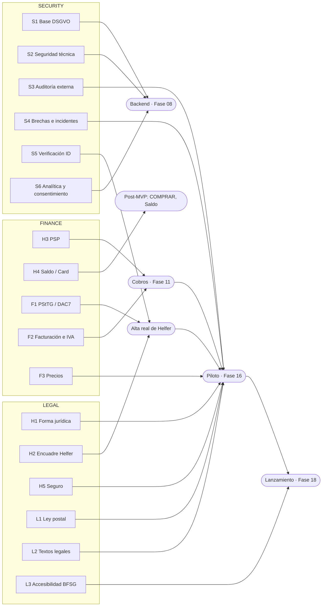

# 00.7 — Gates LEGAL / FINANCE / SECURITY del MVP

| Campo | Valor |
|---|---|
| Fase | 00 Núcleo FARO |
| Estado | REVIEW (pendiente de aprobación humana) |
| Criterio de aceptación | Cada gate con responsable y qué desbloquea |
| Evidencia | Este documento |
| Depende de | 00.1–00.6 |

## 1. Resumen

El MVP tiene **17 gates**. Ninguno bloquea el diseño de la Fase 00, pero:

- **3 tienen que cerrarse antes de empezar el backend** (Fase 08).
- **15 tienen que cerrarse antes del piloto** (Fase 16).

Todas las decisiones son de **Intamar** como fundador/a. Cada gate indica qué profesional externo tiene que confirmarlo por escrito. Un gate solo se cierra con evidencia escrita, guardada en el repositorio o enlazada desde el tablero. Una conversación o una suposición no bastan.

Los gates H1–H5 vienen del CLAUDE.md. Los demás (L, F, S) han salido al definir 00.1–00.6.

## 2. Mapa: qué bloquea cada gate

Una flecha de un gate a un hito significa que ese hito no empieza sin el gate cerrado. «Alta real de Helfer» y «Cobros» también son condición del piloto.

## 3. Gates

### 3.1 LEGAL

| ID | Decisión | Responsable | Qué desbloquea | Evidencia para cerrarlo |
|---|---|---|---|---|
| **H1** | Forma jurídica (p. ej. UG) y Steuerberater | Intamar + Steuerberater + notario | Contratos, facturación, F1, F2, textos legales (L2) y piloto | Inscripción en el Handelsregister y encargo firmado al Steuerberater |
| **H2** | Encuadre legal del Helfer (Directiva de Trabajo en Plataformas, riesgo de falso autónomo) | Intamar + abogado/a laboral | Alta real de Helfer (00.3, A2), condiciones de Helfer, las claves H2 de 00.6 §4.5, desactivar Helfer (00.5, P2), horario de servicio (00.6, P3) y valoraciones (00.2, P6) | Dictamen escrito del abogado/a |
| **H5** | Seguro de responsabilidad para mandados | Intamar + corredor/a de seguros | Valor máximo por objeto (`limits.max_item_value_cents`), plazo de retención de evidencias, reclamaciones (T16) y piloto | Póliza firmada con las coberturas y exclusiones del MVP |
| **L1** | ¿El transporte de paquetes y documentos de terceros exige licencia o notificación ante la Bundesnetzagentur (PostG)? | Intamar + abogado/a | Categorías `task_documents`, `task_parcel_return` y `task_parcel_pickup` en el piloto (00.1, P4) | Dictamen escrito; si hace falta notificación o licencia, el justificante |
| **L2** | Textos legales: AGB del Cliente, condiciones del Helfer, Datenschutzerklärung, Impressum y derecho de desistimiento del consumidor (Widerrufsrecht en servicios contratados a distancia) | Intamar + abogado/a | Registro público (00.2, R3; 00.3, A2) y piloto | Textos revisados, versionados en `country.legal_docs` |
| **L3** | ¿Aplica a FARO la ley de accesibilidad (BFSG) o alguna exención? | Intamar + abogado/a | Lanzamiento. No cambia el diseño: WCAG 2.2 AA ya es obligatorio por el CLAUDE.md | Nota escrita |

### 3.2 FINANCE

| ID | Decisión | Responsable | Qué desbloquea | Evidencia para cerrarlo |
|---|---|---|---|---|
| **H3** | PSP regulado que confirme por escrito que puede cobrar al Cliente y pagar al Helfer | Intamar + PSP + abogado/a (ZAG) | Pasos de pago de 00.2 (P8, C3), Vergütung de 00.3 (C2), efectos económicos de 00.4, el modelo de pagos (00.5 §6), la Fase 11, la verificación del Helfer si se usa el KYC del PSP (S5) y el piloto | Confirmación escrita del PSP sobre el flujo de fondos |
| **H4** | Proveedor regulado para Saldo / FARO Card | Intamar + proveedor + abogado/a (ZAG / BaFin) | Modalidad COMPRAR, Saldo y FARO Card. **Fuera del MVP** | Contrato y confirmación escrita |
| **F1** | Obligación de informar a Hacienda (PStTG / DAC7) de los ingresos de los Helfer | Intamar + Steuerberater | Qué datos fiscales se piden al Helfer (00.3, P2), `country.tax_reporting` y alta real de Helfer | Nota escrita del Steuerberater |
| **F2** | Modelo de facturación e IVA: quién factura a quién la tarifa de servicio y la Vergütung | Intamar + Steuerberater | `country.vat`, la Fase 11 y los cobros | Nota escrita; depende de H1, H2 y H3 |
| **F3** | Modelo de precios: tarifa de servicio y Vergütung por categoría y zona | Intamar | `pricing.*` (00.6 §4.6), la Fase 03 y el piloto | Documento de la Fase 03 aprobado |

### 3.3 SECURITY

| ID | Decisión | Responsable | Qué desbloquea | Evidencia para cerrarlo |
|---|---|---|---|---|
| **S1** | Base DSGVO: registro de actividades de tratamiento (Art. 30), contratos de encargo (Art. 28) con Supabase, PostHog, Sentry, PSP y proveedor de identidad, alojamiento en la UE, evaluación de impacto (Art. 35) y si hace falta delegado/a de protección de datos | Intamar + asesor/a de protección de datos | Backend (Fase 08), que es cuando se tratan datos reales | Registro de actividades, contratos de encargo firmados y decisión documentada sobre la evaluación de impacto y el delegado/a |
| **S2** | Seguridad técnica de base: tests de RLS por tabla (matriz de 00.5 §4), secretos en variables de entorno, MFA para el personal de FARO, copias de seguridad con prueba de restauración y logs sin datos personales | Responsable técnico/a | Backend (Fase 08): se cumple desde el primer commit de backend | Tests de RLS en CI y checklist firmado |
| **S3** | Auditoría de seguridad externa (pentest) antes de recibir datos reales | Intamar + empresa auditora | Piloto | Informe con los hallazgos críticos y altos corregidos |
| **S4** | Proceso de brechas de datos (notificación en 72 h, Art. 33) e incidentes graves durante un mandado | Intamar + soporte (Fase 15) | Piloto | Procedimiento escrito y un simulacro |
| **S5** | Proveedor de verificación de identidad del Helfer y su tratamiento de datos | Intamar + asesor/a de protección de datos | Alta real de Helfer (00.3, A3). Puede resolverse con el KYC del PSP (H3) | Contrato y contrato de encargo |
| **S6** | Analítica y errores conforme al consentimiento (TDDDG / DSGVO): PostHog sin datos personales o con consentimiento, y Sentry con datos personales filtrados | Responsable técnico/a + asesor/a de protección de datos | Integrar PostHog y Sentry (Fase 08) | Configuración documentada y banner de consentimiento si hace falta |

## 4. Reglas de trabajo con gates

1. **Mientras un gate está abierto**, se puede diseñar y programar lo que **no depende** de él. Lo que depende queda como configuración desactivada o marcado BLOCKED, con el gate citado.
2. **Cerrar un gate** = añadir la evidencia (o su enlace, si es confidencial) en `docs/gates/<ID>.md`, cambiar su estado en el tablero y revisar las preguntas abiertas que dependían de él.
3. **Documentos confidenciales** (contratos, dictámenes) no se suben al repositorio: se guarda un resumen sin datos sensibles y dónde está el original.
4. **Un gate cerrado puede reabrirse** si cambia la ley, el proveedor o el alcance. Se anota el motivo.

## 5. Orden recomendado

1. **Ya (en paralelo):** H1, H2 y H3. Son los que más tiempo tardan y de los que más depende. H3 decide también S5 y parte de F2.
2. **Antes de la Fase 08:** S1, S2 y S6.
3. **Antes de dar de alta Helfer reales:** F1 y S5.
4. **Antes del piloto:** H5, L1, L2, F2, F3, S3 y S4.
5. **Antes del lanzamiento:** L3.
6. **Post-MVP:** H4.

## 6. Preguntas abiertas (decisión humana)

- **P1.** ¿Hay ya algún profesional contratado (abogado/a, Steuerberater, corredor/a)? Si es así, conviene ponerlo en la columna de responsable.
- **P2.** ¿L1 (PostG) y L2 (textos legales) los lleva el mismo abogado/a que H2? Propuesta: un único despacho con experiencia en plataformas para H2, L1 y L2.
- **P3.** ¿Responsable técnico/a de S2 y S6? Si no hay nadie más, es Intamar, con Claude Code como apoyo en la implementación.

## 7. Cómo se verifica

- Cada gate tiene responsable, qué desbloquea y la evidencia necesaria para cerrarlo.
- Cada BLOCKED o pendiente citado en 00.1–00.6 apunta a un gate de este documento.
- El mapa (sección 2) renderiza en Mermaid y coincide con las tablas.
